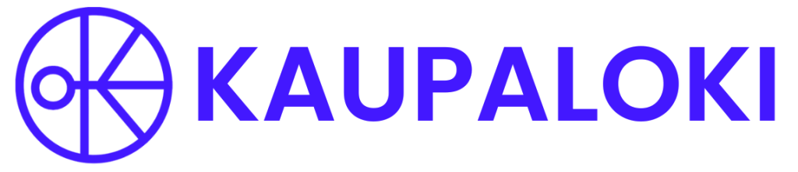

# KAUPALOKI · Guía de identidad

Kit de entrega · 23 de noviembre de 2026

Esta guía reúne la identidad que utiliza actualmente Kaupaloki: archivos originales, colores de la aplicación y tipografía. Las pautas de composición y tamaños indicadas como recomendaciones sirven para producir nuevas piezas; no sustituyen un manual original del diseñador.

## 1. Qué incluye el kit

- **logos/**: logotipo horizontal e isotipo, en violeta y blanco, más el icono social.
- **fuentes/**: Plus Jakarta Sans variable, normal e itálica, licencia OFL y metadatos del proveedor.
- **colores/**: paleta JSON, variables CSS con fuentes locales y archivo GPL de muestras de color.
- **VISTA-PREVIA.html**: referencia visual que funciona sin conexión; permite alternar entre claro y oscuro.
- **INVENTARIO.json**: dimensiones, procedencia y huellas SHA-256 para identificar los archivos.

Los PNG se conservan sin retoques ni cambios de color. No se encontraron archivos maestros vectoriales del logotipo o isotipo en la carpeta de marca. Por tanto, este kit no incluye supuestos originales SVG, AI o EPS ni reconstrucciones del símbolo. El favicon SVG genérico de la aplicación no representa el isotipo y no se presenta como recurso de marca.

## 2. Logos y versiones

| Archivo | Tamaño original | Fondo | Uso principal |
| --- | --- | --- | --- |
| `logos/kaupaloki-logo-violeta.png` | 1024 × 222 px | Transparente | Encabezados claros, documentos, presentaciones y firma de marca |
| `logos/kaupaloki-logo-blanco.png` | 1024 × 222 px | Transparente | Fondos oscuros, portadas, banners y comunicaciones con fondo de color |
| `logos/kaupaloki-isotipo-violeta.png` | 512 × 512 px | Transparente | Avatar sobre fondo claro, carga, navegación y espacios cuadrados |
| `logos/kaupaloki-isotipo-blanco.png` | 512 × 512 px | Transparente | Navegación oscura y espacios cuadrados sobre fondo oscuro |
| `logos/kaupaloki-icono-social.png` | 512 × 512 px | Azul con esquinas transparentes | Icono de aplicación, perfiles y notificaciones |

**Logotipo horizontal:** símbolo y palabra KAUPALOKI forman una unidad. Conservar la proporción original, aproximadamente 4.61:1.

**Isotipo:** utilizar el símbolo circular cuando el espacio no permita leer correctamente el nombre completo. Es el recurso adecuado para estados de carga; no sustituirlo por una letra K escrita con una fuente.

**Icono social:** tiene un fondo azul propio y el símbolo blanco. Su composición cuadrada ya está preparada; evitar añadir otro marco o recortarlo más.

### Recomendaciones de aplicación

- Mantener una zona libre alrededor del logo de al menos un cuarto de su altura. En el isotipo, dejar al menos un octavo del ancho del archivo.
- Para pantallas, usar el logotipo horizontal desde unos 140 px de ancho y el isotipo desde unos 24 px. Revisar la legibilidad al tamaño real; el grosor de los trazos limita las reducciones extremas.
- En encabezados, una altura cercana a 32 px reproduce el uso actual de la app. Siempre conservar `height: auto` si se fija el ancho.
- No estirar, rotar, inclinar, cambiar los trazos, separar elementos del logo o añadir sombras y degradados al propio dibujo.
- Sobre fotografía o fondos complejos, colocar el logo dentro de una superficie uniforme con contraste suficiente.
- Para impresión grande o señalización, solicitar el maestro vectorial original. Los PNG de este kit tienen resolución finita; no son archivos CMYK ni tienen un perfil de impresión definido aquí.

## 3. Paleta de marca

| Color | HEX | RGB | Caso de uso |
| --- | --- | --- | --- |
| Violeta principal | `#4318FF` | 67, 24, 255 | Acción principal, enlaces destacados, elementos seleccionados y gráficos |
| Violeta sobre oscuro | `#7551FF` | 117, 81, 255 | Variable de acento de marca del tema oscuro |
| Azul profundo | `#0B1437` | 11, 20, 55 | Fondo principal oscuro, portadas y superficies de contraste |
| Blanco | `#FFFFFF` | 255, 255, 255 | Superficies claras y logo invertido |
| Azul del icono social | `#313D9B` | 49, 61, 155 | Fondo del icono social original |

**Diferencia presente en los originales:** el color sólido predominante del isotipo violeta es `#441AFF` (68, 26, 255); el del logotipo horizontal es `#4318FF`. Se documentan ambos y se mantienen los originales. Para componentes nuevos de interfaz, usar el token principal `#4318FF`. Los nombres originales que contienen “blue” son nombres de archivo históricos, no una instrucción para cambiar la paleta.

La app mantiene además clases Tailwind de color primario fijo `#4318FF`; por eso algunas acciones conservan ese tono también en oscuro, aunque la variable `--brand-primary` cambie a `#7551FF`. El CSS incluido conserva los valores actuales, sin unificar artificialmente esas variantes.

### Superficies y texto: tema claro

| Función | HEX |
| --- | --- |
| Fondo de página | `#F4F7FE` |
| Tarjetas y menú | `#FFFFFF` |
| Superficie secundaria | `#F7FAFC` |
| Bordes | `#E0E5F2` |
| Texto principal | `#2B3674` |
| Texto secundario | `#707EAE` |
| Texto accesorio | `#A3AED0` |

### Superficies y texto: tema oscuro

| Función | HEX |
| --- | --- |
| Fondo de página | `#0B1437` |
| Tarjetas y menú | `#111C44` |
| Superficie secundaria y bordes | `#1B254B` |
| Texto principal | `#FFFFFF` |
| Texto secundario | `#A3AED0` |
| Texto accesorio | `#707EAE` |

### Colores funcionales

| Función | HEX | Uso |
| --- | --- | --- |
| Éxito | `#05CD99` | Confirmación, ingresos y operaciones completadas |
| Advertencia | `#FFB547` | Pendientes, atención y tránsito |
| Error / salida destacada | `#EE5D50` | Errores, acciones destructivas y egresos resaltados |
| Información | `#38BDF8` | Mensajes informativos y apoyo visual |

Reservar los colores funcionales para su significado; evitar convertir todos los indicadores en colores de decoración. Acompañar los estados con texto o iconos, no solo color. Los grises más claros no deben usarse para textos pequeños esenciales sin revisar su contraste.

### Transparencias y tratamientos existentes

- Acento suave claro: `rgba(67, 24, 255, 0.08)`.
- Acento suave oscuro: `rgba(117, 81, 255, 0.15)`.
- Los estados funcionales tienen fondos suaves al 10% en claro y 15% en oscuro.
- Las tarjetas usan sombras suaves; las superficies oscuras usan sombras negras.
- En comprobantes de tokens aparece una variante de tesorería con degradado `#0B2540` → `#080F1E`, tarjeta `#101D30` y borde `#284461`. Es un tratamiento de comprobantes, no reemplaza la paleta principal.
- Los correos existentes utilizan el degradado `#0B1426` → `#172554` → `#4318FF` en su encabezado.

Los valores completos, incluidas sombras y transparencias, están en `colores/paleta.json` y `colores/kaupaloki.css`.

## 4. Tipografía

### Principal: Plus Jakarta Sans

Es la fuente declarada para la interfaz. La app carga los pesos **400, 500, 600, 700 y 800**. El kit incluye los archivos variables originales normal e itálico para trabajar localmente, con rango de peso **200–800**, según sus metadatos.

| Peso | Uso recomendado |
| --- | --- |
| 400 · Regular | Párrafos y descripciones |
| 500 · Medium | Etiquetas y texto de apoyo |
| 600 · Semibold | Botones, navegación y énfasis breve |
| 700 · Bold | Títulos de sección y encabezados |
| 800 · ExtraBold | Cifras importantes y títulos destacados |

Las asignaciones son una guía de producción coherente con la app, no una regla rígida para cada componente. Usar itálica solo cuando el contenido lo necesite; no es el estilo general de navegación.

**Jerarquía sugerida:** 24–32 px para títulos de página, 18–24 px para secciones, 14–16 px para texto de lectura y 12–14 px para etiquetas. Los tamaños menores usados en tablas del dashboard son densidad de interfaz, no una recomendación para documentos impresos o textos extensos.

### Importes y códigos

Para números alineados, usar `font-variant-numeric: tabular-nums`. La app también usa una pila monoespaciada del sistema para códigos y ciertos montos: `ui-monospace, SFMono-Regular, Menlo, Monaco, Consolas, "Courier New", monospace`. Estas fuentes dependen del sistema y no se redistribuyen en el kit.

La interfaz expresa miles con coma y decimales con punto: `1,234,567.89`. Las tasas se muestran con cuatro decimales; Inicio usa importes sin decimales. Estas reglas de formato no cambian los valores guardados.

### Logotipo y correos

- La fuente del texto del logotipo no está identificada en los archivos disponibles. Utilizar el PNG original; no reconstruir KAUPALOKI escribiéndolo con Plus Jakarta Sans.
- Los correos actuales usan una pila de sistema por compatibilidad: `-apple-system, BlinkMacSystemFont, "Segoe UI", Roboto, Helvetica, Arial, sans-serif`.
- Los comprobantes generados en canvas pueden usar fuentes de sistema como Segoe UI y Consolas. Es un uso técnico distinto de la fuente principal de la app.

### Instalación y licencia

En Windows o macOS, abrir los TTF de `fuentes/` e instalarlos en el sistema. Son fuentes variables: en programas compatibles se pueden elegir sus distintos pesos con el mismo archivo.

Los archivos proceden del [repositorio oficial de Google Fonts](https://github.com/google/fonts/tree/main/ofl/plusjakartasans), bajo SIL Open Font License 1.1. Se incluye `fuentes/OFL.txt`; conservar la licencia al redistribuir las fuentes. Esta licencia cubre las fuentes, no otorga derechos sobre la marca Kaupaloki.

## 5. Casos de uso

| Pieza | Logo | Fondo y tipografía |
| --- | --- | --- |
| Web y portal de cliente | Horizontal violeta | Fondo claro; Plus Jakarta Sans; botones violeta |
| Dashboard oscuro | Horizontal blanco o isotipo blanco | Azul profundo; tarjetas azul oscuro; texto claro |
| Avatar, app y notificación | Icono social | Usar el archivo cuadrado original |
| Pantalla de carga o menú compacto | Isotipo violeta o blanco | Elegir variante por contraste con el fondo |
| Documento o presentación clara | Horizontal violeta | Blanco o gris muy claro; títulos violeta o azul profundo |
| Portada o banner oscuro | Horizontal blanco | Azul profundo; acentos discretos, sin efectos sobre el logo |
| Correo | Horizontal blanco en encabezado oscuro | Texto de sistema; botón `#4318FF` |
| Comprobante de tesorería | Isotipo o logo blanco | Tratamiento oscuro de comprobantes; cifras claras y jerarquía simple |

Para fotografía, tarjetas impresas, bordados y piezas de gran formato no existe una especificación original en los archivos revisados. Preparar cada arte con el proveedor y conservar la forma del símbolo y los colores de referencia; solicitar vectores y pruebas de impresión cuando corresponda.

## 6. Uso web básico

```html
<link rel="stylesheet" href="colores/kaupaloki.css">

```

```css
.mi-pieza {
  font-family: "Plus Jakarta Sans", sans-serif;
  color: var(--text-primary);
  background: var(--bg-main);
}
.mi-boton {
  background: #4318FF;
  color: #FFFFFF;
  border-radius: 12px;
}
```

Agregar la clase `dark` a `<html>` activa la paleta oscura incluida. Cambiar el archivo del logo a la versión blanca cuando corresponda. La vista previa muestra ejemplos de estas combinaciones.

## 7. Procedencia

Identidad visual extraída de `public/`, `src/index.css`, `tailwind.config.js`, `index.html`, el generador de comprobantes y las plantillas de correo del proyecto Kaupaloki. Los cinco originales coinciden con los recursos de la carpeta de marca. El inventario detalla los nombres originales y hashes de los archivos entregados.

No se incluyen datos de clientes, comprobantes operativos, credenciales, código de autenticación ni logos de instituciones financieras externas.
